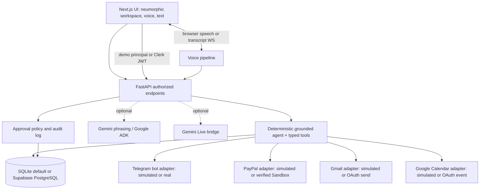

# Visun — Product Requirements Document (PRD)

**Product:** Visun  
**Tagline:** Talk. Manage. Execute.  
**Version:** 1.2 (implemented hackathon MVP — aligned with frontend, backend, and tech stack)  
**Status:** Implemented; demo runs credential-free in simulated mode  
**Last updated:** 3 November 2026  
**Primary users:** Freelancers and independent service providers  
**Target:** PayPal AI Hackathon prototype  
**Companion specifications:** `frontend.md`, `backend.md`, `techstack.md`

> **Decision log (v1.2):** The shipped product runs credential-free: `AUTH_MODE=demo`, `PROVIDER_MODE=simulated`, SQLite, and a deterministic grounded agent. Production switches to Clerk JWT verification, PostgreSQL/Supabase, real provider adapters, and optional Gemini/ADK through environment variables. Clerk is the production identity provider; Supabase is the production Postgres option. The UI uses the approved orange/black/yellow/stone/off-white palette with light neumorphism and an in-repo design system. Simulated actions are always labelled simulated — never reported as real provider successes.

---

## 1. Executive summary

Visun is a **voice-first, transparent AI operations workspace for freelancers**, presented in an editorial, light-neumorphic interface. A user can ask naturally about project deadlines, outstanding payments, client requests, incoming leads, and progress reports. Visun retrieves information from **authorized, connected data sources**, displays the evidence supporting its answers, and can **prepare and execute approved actions** such as sending client emails, creating calendar entries, generating reports, and initiating supported PayPal payment-request workflows.

Visun's distinguishing feature is **contextual scope-change detection**: it compares client messages against the agreed statement of work, highlights potentially unpaid changes, and helps a freelancer propose a priced amendment. The voice assistant, text chat, action timeline, and project dashboard share a single source of truth. Voice conversations are transcribed and saved as searchable chat history when the user enables that feature.

The MVP must demonstrate **real tool calls over persisted workspace data** and, when live credentials are configured, **real PayPal Sandbox state changes** — never mocked payment success. In the default simulated mode every provider action is clearly labelled as simulated with a `sim-*` reference. It must not claim to provide legal escrow or silently monitor private chats.

> **Implementation note:** The demo answer path is grounded in SQLite rows and deterministic tools. Choosing simulated provider mode does not weaken the workflow: prepare → approve → execute → audit still runs, but the provider receipt is explicitly simulated. Switching `PROVIDER_MODE=real` with credentials is what turns a sandbox action into a real provider call.

## 2. Problem statement

Independent freelancers run their businesses across disconnected tools: messenger conversations, email, invoices, calendars, spreadsheets, and payment dashboards. Important client requests get buried in messages, payments become difficult to track, and unplanned work is sometimes performed without updated fees or deadlines. Existing tools may solve individual tasks, but switching between them makes it hard to answer questions such as:

- What must I deliver today?
- How much has this client paid, and what is still outstanding?
- Did yesterday's request exceed the agreed scope?
- Can you generate today's progress report and email it to the client?
- Which leads came in today?

Visun consolidates these workflows into one accountable assistant, without presenting the LLM's guesses as authoritative financial or contractual facts.

## 3. Product vision and positioning

**Vision:** Make managing freelance work as simple as having a conversation—with transparent, verifiable actions.

**Core promise:** Ask in voice or text → inspect grounded answers → approve consequential actions → see confirmed outcomes → revisit the complete history.

**Differentiation:** Voice-driven execution + agreement-aware scope tracking + traceable financial workflows. Visun is **not** a freelance marketplace, general-purpose personal finance assistant, replacement for an accountant/lawyer, or escrow provider.

## 4. Target users

### Primary persona: Independent freelancer

A developer, designer, writer, or consultant managing 2–10 concurrent clients through multiple channels. Needs to know deadlines, approved scope, payment status, and next actions without maintaining many dashboards.

### Secondary persona: Small agency operator (post-MVP)

Coordinates several contributors and client accounts; needs shared visibility, role-based approvals, and reporting.

### Client persona (limited MVP role)

Receives project reports, change requests, invoices, and payment links; may approve scope changes through a shareable, secure client review page.

## 5. Goals and non-goals

### Goals

1. Answer project, deadline, lead, and payment questions from real stored records using voice or text.
2. Receive authorized Telegram project messages and detect candidate scope changes against a baseline agreement.
3. Show exactly which messages, scope clauses, and records support each result.
4. Generate reports and draft/send emails only after clear approval.
5. Demonstrate a PayPal Sandbox invoice/payment-request or checkout workflow and reconcile status from the provider.
6. Save final voice transcripts, assistant replies, approvals, and tool results as an inspectable history.
7. Build a polished, reproducible three-minute hackathon demo.

### Non-goals for MVP

- Reading arbitrary WhatsApp personal chats or unrestricted Discord histories.
- Holding funds in escrow or guaranteeing contractor payment.
- Autonomous transfers without provider authorization and user confirmation.
- Automatically determining contractual liability or conclusively resolving disputes.
- Full CRM, accounting, payroll, banking, or marketplace functionality.
- Training models on users' messages.
- Production-scale multi-tenant enterprise security certification.

## 6. MVP scope and prioritization

| Priority | Capability | MVP requirement |
|---|---|---|
| P0 | Clerk authentication and workspace | Clerk sign-in/sign-up; isolate projects, clients, and data by authenticated workspace |
| P0 | Project setup | Create project, agreed scope, milestones, client, due dates |
| P0 | Unified text + voice chat | Ask questions through supported Gemini Live voice and text; show interim/final transcripts and replies |
| P0 | Persistent history | Store finalized voice/text messages, source citations, tool calls, approvals and verified outcomes in Supabase PostgreSQL |
| P0 | Project/deadline answers | Retrieve and explain actual project records |
| P0 | Payment visibility | Store invoices; query and reconcile PayPal Sandbox state |
| P0 | Telegram intake | Authorized test-group messages via bot webhook or polling |
| P0 | Scope-change detection | Compare messages to the stored agreement; flag uncertain cases |
| P0 | Action approval | Draft → preview → explicit confirmation → execute → verify |
| P0 | Email reminders | Draft and send through an authorized email integration |
| P0 | Report generation | Generate a concise project status report; send after confirmation |
| P1 | Calendar integration | Read Google Calendar events and create approved events |
| P1 | Lead dashboard | Manual lead records and questions such as “today's leads” |
| P1 | Voice-driven lead actions | Summarize and create follow-ups from stored leads |
| P2 | Discord bot | Process messages from permitted project channels |
| P2 | WhatsApp Business Cloud API | Supported business-number conversations only |
| P2 | Team roles and shared workspaces | Members and client-specific permissions |
| P2 | Additional reports | PDF export, analytics, recurring summaries |

**MVP cut line:** If time is limited, complete P0 items before any P1 or P2 integrations. For the demo, an in-app task calendar and a seeded lead can answer questions even before Google Calendar and external CRM integration are available; label such data clearly as demo data.

## 7. Primary user journeys

### Journey A — Ask for deadlines

1. User signs in and starts a voice or text session.
2. User asks: “What are my deadlines today?”
3. Assistant invokes `get_deadlines(date, timezone)` for the authenticated workspace.
4. UI displays milestones, due times, project names, and source links; agent reads a concise answer aloud.
5. Transcript and read-only tool result appear in history.

**Acceptance:** No hallucinated tasks; when none exist, agent says so and notes which source was checked.

### Journey B — Detect and price scope creep

1. Freelancer saves an original agreement, including acceptance criteria.
2. Client posts in an opted-in Telegram project group: “Can you also add login and a payment page?”
3. Visun normalizes the message, ties it to the correct project, and runs scope analysis.
4. Visun labels each request as `within_scope`, `potential_change`, or `insufficient_context`; shows agreement-clause and message citations, confidence, and a reason.
5. Freelancer asks by voice: “What changed on Rahul's website project?”
6. Visun explains the additional request and prepares a **draft** change order with an editable estimate.
7. Freelancer reviews and explicitly approves sending the change request and supported PayPal payment request.

**Acceptance:** Detection never silently changes a contract or bills a client; estimated effort is marked as a proposal, not fact.

### Journey C — Payment follow-up

1. User asks: “How much does Rahul still owe me?”
2. Agent reads project invoice records and verified PayPal payment status.
3. UI shows invoiced, verified paid, outstanding, due date, and last synced time.
4. User says: “Email Rahul a reminder.”
5. Agent creates a draft with recipient, subject, amount, invoice reference, and payment link if available.
6. User previews and confirms; backend sends with an authorized Gmail account or configured email provider.
7. Activity log stores provider message ID and final send status.

**Acceptance:** No email sent before approval; no claim that the client read an email based solely on a successful send response.

### Journey D — Generate and send a report

1. User says: “Generate a progress report for my website project and send it today.”
2. Agent fetches milestones, completed tasks, open issues, pending changes, and payment summary where relevant.
3. Report is generated, displayed as an editable preview, and saved as an artifact.
4. User explicitly confirms recipient, report content, and sending action.
5. Backend emails report and logs provider confirmation.

**Acceptance:** Every quantitative statement is traceable to stored records; missing information is shown as unknown.

### Journey E — Today's leads

1. User says: “Show me today's leads.”
2. Agent queries leads entered in the workspace (or authorized CRM connector in later iterations).
3. Results include source, contact, stage, received date, and next action.
4. Agent may draft follow-up emails, requiring approval to send.

**Acceptance:** The agent never claims to discover external leads unless a source has actually been connected.

## 8. Functional requirements

### FR-01 — Identity, workspaces, and permissions

- **Clerk is the only user-facing authentication system.** Use Clerk Next.js SDK and supported backend JWT validation; do not build a parallel Supabase Auth sign-in flow.
- **Supabase is the data platform:** PostgreSQL for operational data; private Storage buckets for documents and reports; Realtime for authorized updates.
- Map Clerk's stable user ID to the internal user/workspace membership. Verify session claims and check workspace membership on every protected FastAPI route and agent tool.
- Use a documented Clerk–Supabase third-party-token/RLS integration if the browser accesses Supabase directly; otherwise route database access through FastAPI with server-side authorization. Never expose service-role credentials in the browser.
- Authentication and workspace authorization are separate checks. An authenticated user does not automatically gain access to every workspace.
- Authenticated access is required for workspace records and integrations.
- Each project, conversation, message, invoice, and report belongs to a workspace and is access-controlled.
- Users can connect/revoke individual integrations.
- UI displays connected platform, access scope, and last sync time.

### FR-02 — Projects and source-of-truth data

- Create, edit, and archive clients/projects.
- Upload or paste an agreement; retain original document and versioned extracted scope clauses.
- Store milestones with owner, due date, state, acceptance criteria, and price when agreed.
- Record activity notes and source references.

### FR-03 — Voice and text agent

- Offer a unified chat thread for microphone and typed messages.
- Use a **verified, currently supported Gemini Live-compatible model** for streaming voice; model names and feature support must be confirmed in Google documentation at implementation time. Do not hard-code an unverified `gemini-3.8-live` model identifier.
- Support spoken responses and interruptible sessions where the selected model/client permits.
- Stream partial transcript to the UI; persist finalized transcript segments with timestamps and speaker attribution when available.
- Route tool requests through authenticated backend actions; never grant the LLM direct API secrets.
- If Live API access is unavailable, provide a speech-to-text → text-model function calling → text-to-speech fallback.

### FR-04 — Grounded agent tools

Minimum backend tools (names are illustrative):

```text
get_deadlines(date, project_id?)
get_project_status(project_id)
get_scope_agreement(project_id)
get_client_messages(project_id, since?)
analyze_scope_change(project_id, message_ids[])
get_pending_payments(client_id?, project_id?)
get_payment_status(invoice_id)
get_leads(date, status?)
generate_project_report(project_id, period)
draft_payment_reminder(invoice_id)
draft_change_request(project_id, change_ids[])
request_action_approval(action_id)
send_approved_email(action_id)
create_approved_payment_request(action_id)
```

- Read tools must be permission-scoped and return structured data plus source IDs.
- Write tools require an approval token tied to the **exact recipient, content, amount, and action**.
- Prevent duplicate sends/payments with idempotency keys.
- Tool errors appear in the conversation and activity log; do not invent success.

### FR-05 — Client-message ingestion

**Telegram P0:** Dedicated bot in an opted-in project chat; configured group privacy permissions; per-chat allowlist, webhook signature/secret validation when using webhooks, deduplication and mapping to a project.

**Discord P2:** Server/channel bot with required permissions and message-content access, subject to Discord developer policies.

**WhatsApp P2:** Meta WhatsApp Business Cloud API for supported inbound business messaging. It does **not** allow reading arbitrary personal WhatsApp histories. MVP accepts voluntarily uploaded/pasted transcripts, with proper notice and consent.

- Display which chats are monitored and allow pause/disconnect.
- Do not ingest messages from other chats by default.
- Minimize retention of unrelated messages and avoid sending sensitive attachments to AI by default.

### FR-06 — Scope detection

- Compare requested deliverables with **versioned** agreement clauses, not keyword heuristics alone.
- Output classification, evidence references, explanation, and confidence/uncertainty.
- Support human feedback: correct classification, dismiss, or convert into change request.
- Do not represent AI estimates as binding prices; editable price and due date remain user-controlled.

### FR-07 — Payment integration

- Use PayPal Sandbox first, with supported Orders and/or Invoicing APIs depending on account eligibility and chosen flow.
- Show invoice/payment IDs, statuses, currency, amounts, timestamps, and provider links where available.
- Reconcile status from provider API and verified webhooks, not conversational inference.
- Keep payment initiation/release subject to required buyer authorization and user confirmation.
- **No escrow claims**, arbitrary cross-border payout guarantees, or indefinite authorizations.
- Check API availability, business-account permissions, region and currency constraints before implementing a specific flow.

### FR-08 — Email and reports

- Connect Gmail via OAuth with minimum necessary scopes; if unavailable, use an explicitly configured transactional-email alternative.
- Generate edit-friendly report in Markdown/HTML; optional PDF in a later milestone.
- Preview recipient, subject, content, attachment(s), and referenced amounts.
- Record approval, sent message ID, and delivery errors separately.
- Never send emails silently based only on conversational context.

### FR-09 — Calendar and leads

- MVP in-app milestone calendar; Google Calendar integration P1 with OAuth for authorized accounts.
- Manual CRM leads table P1. Optional external CRM integration later.
- “Today's” boundaries use the user's workspace timezone, defaulting to a user-configured value, not the server timezone.

### FR-10 — Conversation and action history

- Persist typed messages and **final** voice transcripts as a single threaded conversation.
- Store assistant responses, tool-call lifecycle, evidence links, approvals/rejections, generated artifacts, and actual execution outcomes.
- Distinguish `drafted`, `awaiting_approval`, `approved`, `executing`, `succeeded`, and `failed` states.
- Users can search conversations and open an action to inspect what happened and why.
- Allow deletion/export of conversation history and configurable retention. Voice audio should not be retained by default; transcript retention should be user-visible and controllable.

## 9. User experience and main screens

### Required visual identity and component behavior

Visun uses **warm, light neumorphism (Soft UI) plus editorial landing-page composition**, as specified in `frontend.md`. Apply it across product screens, not just the marketing site.

| Approved core color | Hex | Primary role |
|---|---|---|
| Vivid orange | `#FF5A00` | Main CTAs, active microphone/voice state, primary accent |
| Near-black | `#1D1D1D` | Headlines, primary text, navigation |
| Soft yellow | `#FFE17B` | AI insights and contextual highlights |
| Warm stone | `#E9E6DF` | Sidebars, muted cards, secondary surfaces |
| Off-white | `#F8F8F6` | Main page background and neutral raised surfaces |

- Use directional **raised** soft shadows for stat/project cards and neutral buttons, **inset** treatment for inputs and the chat composer, and a tactile raised voice orb.
- Keep long transcripts, data tables, payment figures, and history lists mostly flat for readability; avoid shadows around every item.
- Retain visible text labels and semantic states (`Pending`, `Needs approval`, `Sent`, `Paid`, `Failed`). Do not use shadow or color alone to indicate status.
- Preserve keyboard focus rings, accessible contrast, 44px practical touch targets, responsive layouts, and reduced-motion settings.
- Marketing may borrow Updraft's editorial hierarchy and content rhythm, but the application must prioritize clarity and task completion over decoration.
- Component/library detail and full design tokens remain authoritative in `frontend.md`.

1. **Workspace Home:** Today's deadlines, outstanding payment totals, scope alerts, new leads, recent activity.
2. **Copilot:** Voice controls + streaming captions + chat messages + expandable tool traces + approval cards.
3. **Projects:** Agreement, milestones, messages, progress, client, pending changes, payment summaries.
4. **Scope Inbox:** Candidate changes with message quote, agreement citation, confidence, accept/dismiss actions.
5. **Payments:** Invoices, paid/outstanding breakdown, PayPal verification timestamp, reminder actions.
6. **Reports:** Generated reports, previews, history, export and send flow.
7. **Calendar:** Deadlines and events, with optional connected calendar.
8. **Leads:** Manual lead pipeline and follow-up status.
9. **Activity & Settings:** Action audit, approvals, connected sources, privacy controls, data retention.

### Transparent action UI contract

Every significant agent action displays:

- **What** it intends to do.
- **Why**, with relevant source links.
- **Which account** and **which recipient** it will affect.
- **What data or money** is involved.
- **Whether approval is required** and its current state.
- **Actual provider result**, including failures and retriable errors.

## 10. High-level architecture



**Authoritative stack:** Next.js 16 + TypeScript + Tailwind CSS 4 with an in-repo editorial/neumorphic UI kit; Python FastAPI + SQLModel + Alembic; SQLite default and PostgreSQL/Supabase via `DATABASE_URL`; demo auth locally and **Clerk JWT verification** in production; deterministic grounded agent with optional Gemini/ADK; browser speech with optional Gemini Live; Telegram Bot API; PayPal official REST endpoints through adapters; Gmail and optional Google Calendar APIs — each adapter in `simulated` or `real` mode.

**Keep the stack library-first:** Prefer supported official APIs, Pydantic validation, established UI primitives, and generated/hand-written typed clients. Do not hand-build authentication, OAuth flows, database migrations, raw speech streaming protocols, calendar widgets, or payment clients when suitable maintained libraries exist. Do not introduce extra multi-agent services for the MVP.

**Security boundary:** Demo auth is local-only and refused in production. In production Clerk authenticates; FastAPI verifies identity and authorizes the workspace; payment/email/calendar write actions require a backend-generated preview, canonical hash, and explicit user approval. If direct Supabase access is later enabled, RLS must enforce workspace access and Realtime/Storage must be scoped.

**Model IDs:** Gemini model identifiers, regions, rates and Live API capabilities must be verified against active Google documentation before integration. Do not assume that an informal model label is a real API ID.

## 11. Suggested data model

| Table | Essential fields |
|---|---|
| `users` | id, clerk_user_id (unique), email, name, timezone |
| `workspaces` | id, owner_user_id, name |
| `clients` | id, workspace_id, name, email, contact_preferences |
| `projects` | id, workspace_id, client_id, title, status, description |
| `agreements` | id, project_id, version, original_file_ref, extracted_terms, effective_at |
| `scope_clauses` | id, agreement_id, label, description, acceptance_criteria |
| `milestones` | id, project_id, title, due_at, status, price, acceptance_criteria |
| `integrations` | id, workspace_id, provider, permission_scopes, status, last_sync_at |
| `external_messages` | id, project_id, platform, external_id, sender_ref, text, sent_at, consent_scope |
| `scope_findings` | id, project_id, message_ids, clause_ids, classification, rationale, confidence, review_state |
| `invoices` | id, project_id, provider_invoice_id, currency, total, amount_paid, due_at, status, verified_at |
| `leads` | id, workspace_id, name, source, stage, created_at, next_action_at |
| `conversations` | id, workspace_id, user_id, title, created_at |
| `messages` | id, conversation_id, role, modality, text, created_at, source_refs |
| `tool_executions` | id, conversation_id, tool_name, arguments_redacted, status, result_ref, started_at |
| `action_approvals` | id, tool_execution_id, actor_id, payload_hash, status, approved_at, expires_at |
| `action_events` | id, action_id, from_status, to_status, detail, created_at |
| `activity_events` | id, workspace_id, type, actor, title, detail, status, reference, created_at |
| `artifacts` | optional future table for files; the MVP exports locally and stores report metadata |
| `audit_events` | represented by `action_events`, `tool_executions`, `webhook_events`, and `activity_events` |

Notes: The implemented schema uses `integer` cents for money and timezone-aware UTC instants. Demo mode uses a stable seeded `clerk_user_id` so the same rows work after Clerk is enabled. Never use an identity field as the sole authorization check. Store provider secrets server-side; never put credentials or raw sensitive content in audit metadata. Add retention and deletion rules, indexes, and workspace isolation. Supabase Auth login is not part of the product; RLS becomes relevant only if direct browser database access ships.

## 12. Action execution state machine

```text
User asks for action
    ↓
Agent gathers facts and drafts exact payload
    ↓
Preview in UI: recipient / amount / content / attachments
    ↓
Awaiting explicit user approval
    ├── Rejected → Save rejection; do nothing
    └── Approved → Validate payload hash and authorization
                         ↓
                    Execute once
                         ↓
              Confirm provider result
                    ├── Succeeded → Log provider reference
                    └── Failed / uncertain → Log truthfully; provide retry path
```

A changed recipient, amount, attachment, or email body invalidates the prior approval and requires a new one. Voice confirmation can be part of the UX, but high-risk transactions should also use an explicit confirmation UI or equivalent strong authorization.

## 13. Privacy, security, and trust

- **Consent-first ingestion:** Chat monitoring is opt-in, project-specific, clearly disclosed to participating users where appropriate.
- **Identity and isolation:** Clerk session verification plus per-request workspace authorization; apply RLS and private Storage policies where appropriate. Do not expose Supabase service-role keys.
- **Least privilege:** Minimize OAuth scopes and platform bot permissions; disconnect integrations easily.
- **Source grounding:** Financial and project answers must link to records and report verification time.
- **Prompt injection resistance:** Treat incoming client chats and documents as untrusted data, never as instructions to the agent to call tools or override approvals.
- **Action isolation:** Write APIs enforce authorization in code; prompt instructions alone are not safeguards.
- **Payment safety:** Do not expose credentials, send uncontrolled payouts, or claim escrow coverage.
- **Transcript privacy:** Persist only confirmed transcript text by default, show retention controls, and disclose audio processing providers.
- **Secrets and webhooks:** Verify provider signatures/secrets, use HTTPS, token encryption, idempotency, and redacted logging.
- **Financial precision:** Store currency amounts as integer minor units or exact decimals; never use floating-point for accounting totals.
- **Accountability:** Preserve auditable events and provide transparent errors and a clear human override.

## 14. Non-functional requirements

| Category | MVP target |
|---|---|
| Responsiveness | Show partial voice transcript as streaming events arrive; communicate network delays honestly |
| Read answers | Aim for typical project queries to resolve within a few seconds under demo conditions |
| Reliability | Idempotent write actions and webhook deduplication |
| Data isolation | All workspace queries authorized server-side; RLS where user-scoped Supabase access is used |
| Observability | Structured traces for tool calls, webhook events, and approval transitions |
| Accessibility | Keyboard-operable text alternative to voice; captions visible during voice interactions |
| Robustness | Graceful failures if model, email, Telegram, or PayPal is unavailable |
| Cost controls | Model/token limits, rate limits, project-level ingestion quotas |

These are engineering goals, not guarantees of third-party API latency or uptime.

## 15. Measurable success criteria

### Functional acceptance checklist

- [ ] A user can create a project, add a client, save scope clauses, and set two milestones.
- [ ] Asking by voice or text for today's deadlines returns only stored milestones with source links.
- [ ] A consented Telegram test message triggers a visible `potential_change` finding with agreement evidence.
- [ ] Agent can explain the change and create a reviewable, editable change-request draft.
- [ ] User can retrieve unpaid invoice status from a real PayPal Sandbox flow; UI distinguishes cached and verified state.
- [ ] Agent drafts an overdue-payment email, **does not send without approval**, and records successful provider submission.
- [ ] Agent generates a grounded project report and can send it after approval.
- [ ] Finalized voice transcripts and tool/action events remain visible after reloading the app.
- [ ] A rejected action causes no external side effect.
- [ ] A failed provider call is displayed as failed, not as completed.

### Evaluation indicators

- At least one **end-to-end PayPal Sandbox operation** demonstrated.
- At least one **live Telegram message** analyzed against agreement evidence.
- At least one **voice-to-tool-to-result** flow with a persistent transcript.
- Zero unauthorized external actions during tested workflows.
- Demo can be replayed from a prepared seed workspace without depending on a real client.

## 16. Hackathon demo storyboard (target ~3 minutes)

**0:00–0:25 — Problem:** Show scattered client tasks, messages, and payments. Introduce Visun as the single transparent workspace.

**0:25–0:55 — Live scope detection:** A teammate posts an out-of-scope request to a Telegram test group. The Scope Inbox flags the message and cites the agreement.

**0:55–1:25 — Voice interaction:** Ask, “What changed in this project and what is due today?” Visun answers aloud; user sees live captions and evidence links.

**1:25–2:05 — Payment workflow:** Ask, “What payment is left?” Visun checks PayPal Sandbox-backed invoice/payment information, drafts a reminder or payment request, and shows an approval screen.

**2:05–2:35 — Action:** Approve sending a client report/reminder; display provider-confirmed result. If checkout/payment is demonstrated, show the genuine Sandbox status transition.

**2:35–3:00 — Transparency:** Reload conversation history to show voice transcript, source citations, approval, and actual tool outcomes. Close with the user benefit.

## 17. Suggested build sequence

**Phase 1 — Foundation:** Demo workspace schema + seeded data; SQLite default with PostgreSQL/Supabase override; project/client/milestone CRUD; agreements; light-neumorphic design tokens. **Shipped.** Production Clerk wiring is the remaining auth step.

**Phase 2 — Core agent:** Text chat, typed retrieval tools, evidence links, conversation history, approval workflow. **Shipped**, including honest offline fallback.

**Phase 3 — Scope detection:** Telegram-style intake, agreement comparison, scope findings, review states. **Shipped with simulated ingestion; real bot credentials remain.**

**Phase 4 — Payments and communication:** PayPal Sandbox adapter, status reconciliation, email drafts and approved sends, report previews. **Shipped with simulated providers; real credentials remain.**

**Phase 5 — Voice and polish:** Browser speech + transcript fallback, unified history, end-to-end demo rehearsal. **Shipped.** Gemini Live audio transport remains optional and credential-gated.

**Stretch:** Google Calendar OAuth real events, manual CRM lead pipeline, Discord, downloadable PDF reports.

## 18. Risks, assumptions, and mitigations

| Risk / assumption | Mitigation |
|---|---|
| Gemini model identifier/features differ from expectation | Validate official model availability; keep speech fallback |
| PayPal Sandbox APIs or invoice flows vary by region/account | Verify eligibility early; choose one supported end-to-end flow |
| Telegram bot cannot see private chats or all group messages | Use opted-in project group and correct bot permissions |
| Gmail OAuth approval/setup slows demo | Request minimal scopes; prepare approved test account or a clearly labeled email fallback |
| AI misclassifies ambiguous client messages | Evidence-based labels, review queue, corrections, no automatic charge |
| Project data goes stale | Display `last_synced_at` and offer explicit refresh |
| Prompt injection in client messages | Untrusted-data separation; server-side action policy |
| Too many integrations stretch MVP | P0-first scope; one live messaging channel and one real payment flow |
| Clerk identity and Supabase access policies are misconfigured | Validate JWT and workspace membership in FastAPI; demo mode is refused in production. Add RLS tests if browser database access ships |
| Demo data mistaken for live provider data | Every simulated action carries `simulated=true`, a `sim-*` reference, and an explicit UI label; activity copy says no external request was made |
| Neumorphic surfaces reduce readability or accessibility | Follow `frontend.md`: strong type contrast, clear focus, mostly flat dense views, semantic status labels |
| Users view conversational approval as too casual | Structured previews and explicit user-controlled approval |

## 19. Open product decisions

1. **PayPal flow:** Invoicing API or Orders checkout as the main demo path, based on Sandbox account capabilities?
2. **Voice SDK:** Which currently supported Gemini Live model and client transport are best available in the team's region/account?
3. **Email:** Gmail OAuth or transactional-email fallback for hackathon demonstration?
4. **Agreement format:** Structured manually entered scope plus optional document extraction, or extraction-first?
5. **Leads:** Manual lead tracker in MVP or an initial authorized CRM integration?
6. **Reports:** HTML/Markdown email first, with PDF as a stretch goal?

None of these decisions blocks the P0 foundational data model.

## 20. Product principles

**Specification precedence:** `PRD.md` defines scope/behavior; `frontend.md` defines UI design; `backend.md` defines API/security/data flow; `techstack.md` defines selected libraries and SDKs. If two specs conflict, record and resolve the conflict explicitly rather than silently implementing two systems.


1. **No invisible actions.** The user knows what Visun accessed and what it changed.
2. **Evidence over confidence.** Show source records and limitations before polished but unsupported answers.
3. **Approval before consequences.** Money movement and outbound messages are never silently executed.
4. **One history, every modality.** Voice, text, tools, and results live in the same timeline.
5. **Narrow integrations done well.** One working real-world flow is better than many simulated connections.
6. **Assist, don't adjudicate.** The AI proposes scope classifications and decisions; people retain authority.

---

**One-sentence pitch:** *Visun is a transparent, voice-first AI workspace that helps freelancers understand client requests, protect their scope, track PayPal payments, and execute approved business tasks from one conversation.*
